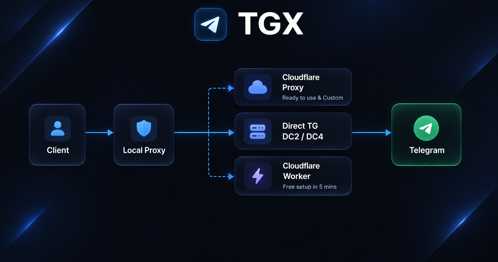

  <a href="README.md">Русский 🇷🇺</a> ·
  <a href="README.en.md">English 🇺🇸</a> ·
  <a href="README.zh-CN.md">简体中文 🇨🇳</a> ·
  <a href="README.de.md">Deutsch 🇩🇪</a> ·
  <a href="README.fr.md"><strong>Français 🇫🇷</strong></a> ·
  <a href="README.es.md">Español 🇪🇸</a> ·
  <a href="README.it.md">Italiano 🇮🇹</a>

<h1 align="center">TGX</h1>

Un proxy local pour Telegram sur Android

  

## Qu’est-ce que TGX ?

TGX est une application Android qui lance sur l’appareil un proxy MTProto local pour Telegram. Elle permet à Telegram d’utiliser un proxy dédié sans faire passer tout le trafic Internet du téléphone par TGX. TGX n’est pas un VPN et ne modifie pas le routage des autres applications. La disponibilité de Telegram dépend du réseau et de la route utilisée ; TGX ne garantit ni le contournement des blocages, ni l’anonymat, ni un fonctionnement sur tous les réseaux.

## Soutenir le projet

Le soutien est facultatif et contribue au développement et à la maintenance de TGX.

- **BTC :** `bc1q7pzjs4wuvffvpr69mcw6ln90gqtxptwmk7jvx5`
- **ETH :** `0x20C407bFF67e3ACbDc916d91b11c3E7A63342e7b`
- **USDT (TRON) :** `TKRdMNhunBajoujiWd9aKXpiVH2GcJeYAg`

## Fonctionnement

  

1. TGX démarre un service Android au premier plan et écoute à l’adresse locale `127.0.0.1:1443`.
2. Telegram s’y connecte comme à un proxy MTProto. TGX examine les premières données MTProto et choisit une route vers un centre de données Telegram.
3. TGX utilise TLS/WebSocket pour le transport : connexions préchauffées, points d’accès WebSocket Telegram, puis domaines proxifiés par Cloudflare. Une route TCP directe est disponible pour les centres de données configurés lorsqu’aucune route WebSocket utilisable n’est disponible.
4. TGX récupère la liste des domaines Cloudflare depuis [Flowseal/tg-ws-proxy](https://github.com/Flowseal/tg-ws-proxy), la valide et l’actualise environ une fois par heure. En cas d’échec du téléchargement, la dernière copie locale valide est conservée.
5. Le service surveille l’état du réseau Android et gère le serveur local ainsi que les connexions amont. Un changement de réseau ou une défaillance de route peut interrompre une connexion ; le fonctionnement n’est pas garanti.

TGX ne traite que les connexions Telegram dirigées vers son proxy local. Ce n’est pas un tunnel VPN couvrant tout l’appareil.

## Installation et démarrage

### 1. Télécharger l’APK

Téléchargez l’application uniquement depuis la page officielle [GitHub Releases](https://github.com/sw1ssl0ve/TGX/releases). Au moment de la rédaction de ce README, aucun Release contenant un APK n’était publié dans le dépôt. N’installez pas de versions provenant de sites tiers.

### 2. Installer l’application

Si un APK est publié, ouvrez-le sur Android et confirmez l’installation. Si Android la bloque, autorisez l’installation d’applications provenant de cette source dans les paramètres de l’appareil. Les intitulés des menus varient selon la version d’Android et le fabricant.

### 3. Autorisations

Android peut demander l’autorisation d’envoyer des notifications. Elle permet à TGX d’afficher le service au premier plan pendant que le proxy local fonctionne ; la notification propose également une action d’arrêt. Même en cas de refus, TGX demande le démarrage du service, mais Android peut masquer sa notification. Il n’est pas nécessaire d’autoriser manuellement l’accès à Internet : l’application déclare la permission `INTERNET` dans son manifeste.

### 4. Première connexion

Ouvrez TGX et démarrez le proxy. Après le premier démarrage réussi, TGX propose une seule fois d’ouvrir Telegram. Confirmez dans TGX, puis ajoutez ou activez le proxy MTProto proposé dans Telegram. TGX ouvre un lien `tg://proxy` avec `127.0.0.1:1443` et votre Secret. Si Telegram n’est pas installé ou ne peut pas ouvrir le lien, TGX affiche un message ; vous pouvez configurer le proxy manuellement dans Telegram avec l’adresse locale, le port et le Secret indiqués dans les paramètres de TGX.

### 5. Vérifier le fonctionnement

Dans Telegram, vérifiez la connexion, le chargement de la liste des discussions et des conversations, puis l’envoi et la réception d’un message de test. Vous pouvez également essayer d’ouvrir une image ou un autre média. Le statut affiché par TGX ne suffit pas à confirmer que Telegram transfère effectivement les données.

### 6. Si Telegram ne se connecte pas

Vérifiez le Secret dans les paramètres de TGX : il doit contenir 32 caractères hexadécimaux. Vous pouvez en générer un nouveau et appuyer sur **Enregistrer et ouvrir Telegram**. TGX l’enregistre, redémarre le service s’il fonctionne déjà ou le démarre, puis ouvre Telegram avec le nouveau lien. Confirmez le proxy dans Telegram et sélectionnez l’entrée actuelle. TGX ne peut ni lire ni modifier la liste des proxys enregistrés dans Telegram. Si Telegram conserve l’ancienne entrée à côté de la nouvelle, sélectionnez le proxy actuel et supprimez manuellement l’entrée obsolète si nécessaire. Si Telegram ne s’est pas ouvert, vérifiez qu’il est installé et ajoutez le proxy manuellement.

## Historique du projet et remerciements

TGX reprend des idées et des approches techniques compatibles du projet [Flowseal/tg-ws-proxy](https://github.com/Flowseal/tg-ws-proxy), notamment le transport de MTProto via WebSocket et le routage par domaines proxy Cloudflare. TGX est une application Android distincte, avec sa propre implémentation Kotlin, son interface et la gestion du cycle de vie d’un service Android ; ce n’est pas un produit officiel de Flowseal.

Merci à Flowseal et aux contributeurs du projet pour la publication de ces travaux. Le dépôt tg-ws-proxy indique la licence MIT ([texte de la licence](https://github.com/Flowseal/tg-ws-proxy/blob/main/LICENSE)). Le dépôt TGX ne contient actuellement aucun fichier `LICENSE` : ce README ne lui attribue donc pas de licence et n’autorise pas la réutilisation de son code. La licence de TGX et l’application éventuelle des exigences MIT aux éléments techniques dérivés doivent être examinées séparément par le propriétaire du dépôt.

## Partager le projet

Si TGX vous est utile, ajoutez une ⭐ au dépôt, partagez-le avec vos proches ou faites-le connaître aux communautés Telegram susceptibles d’en avoir besoin : [github.com/sw1ssl0ve/TGX](https://github.com/sw1ssl0ve/TGX).
